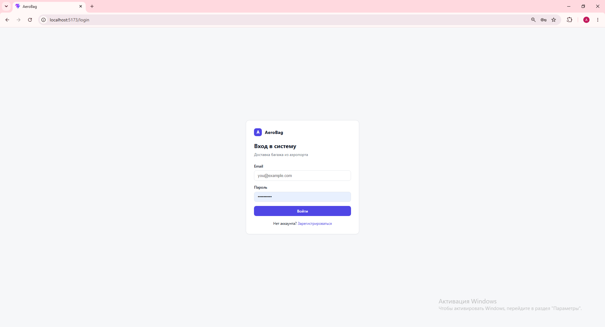
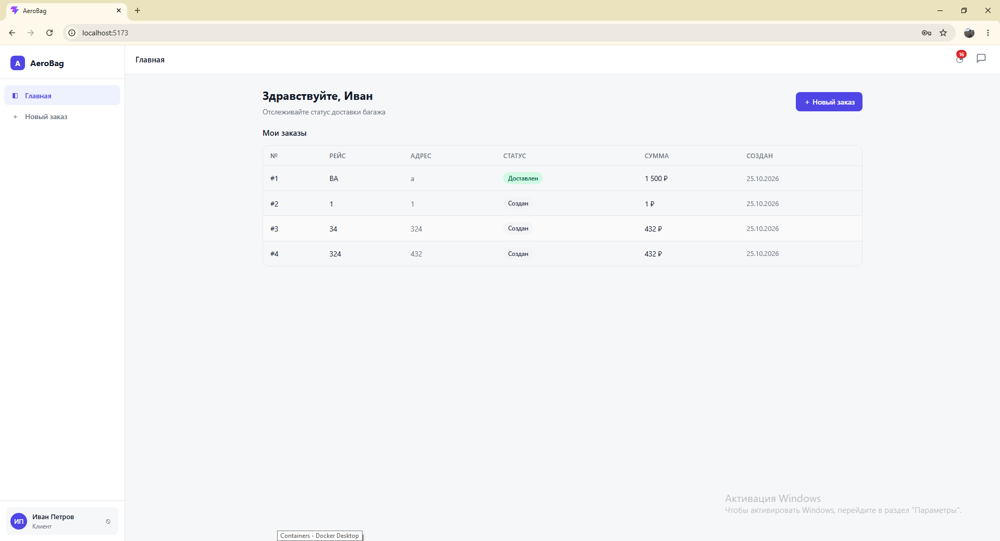
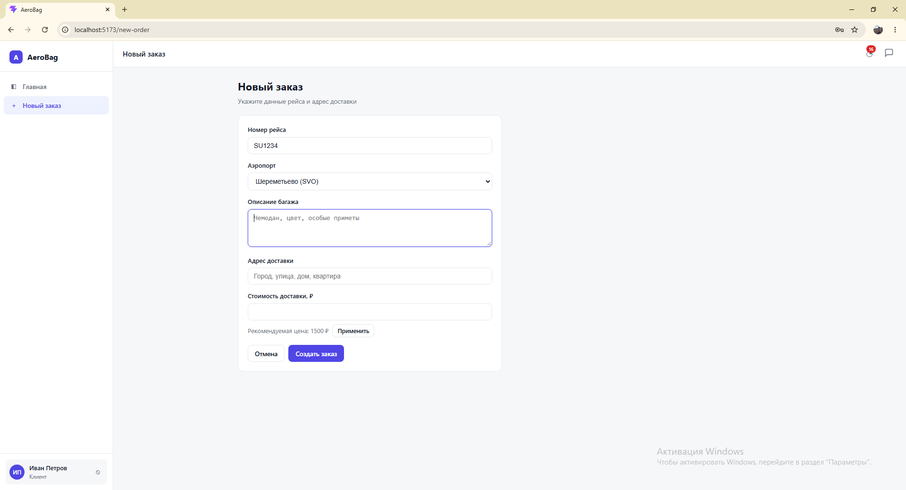
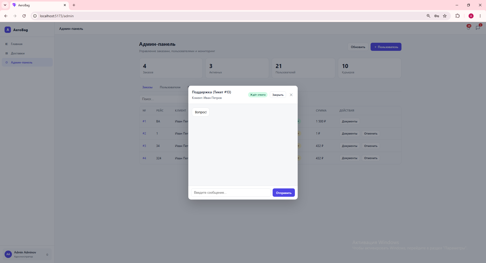
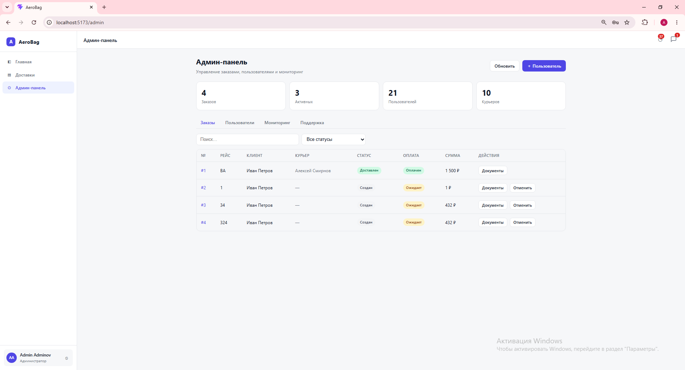

# AeroBag — Доставка багажа из аэропортов

Клиент-серверное приложение для организации доставки багажа из аэропортов. 

## Демо-видео
Ссылка на видео-демонстрацию работы приложения: [ДЕМО.mp4](ДЕМО.mp4)

**Скриншоты интерфейса**
- Страница авторизации:
- Дашборд клиента:
- Создание заказа:
- Чат поддержки:
- Панель администратора:

## Стек технологий
**Бэкенд:**
- Python 3.11
- FastAPI 
- PostgreSQL 
- SQLAlchemy ORM
- MinIO 
- JWT, bcrypt
- Docker, Docker Compose

**Фронтенд:**
- React 18
- TypeScript
- Vite
- React Router v6
- Axios
- CSS

### Бэкенд FastAPI
- JWT аутентификация и авторизация, регистрация, вход, защита эндпоинтов
- CRUD операции для пользователей, заказов и документов
- Ролевая модель: client, courier, admin с разными уровнями доступа
- S3-совместимое хранилище MinIO с генерацией presigned URL для безопасной загрузки и скачивания файлов
- История изменения статусов заказов
- Система уведомлений с хранением в базе данных
- Встроенный чат поддержки с тикетами и сообщениями
- Логирование всех HTTP-запросов в базу данных
- Автоматическое создание тестовых данных при первом запуске
- Docker-окружение PostgreSQL, MinIO, Backend
- Swagger и OpenAPI документация

### Фронтенд React и TypeScript
- Структура проекта на Vite с TypeScript
- Компонентная архитектура со страницами входа, регистрации, заказов
- Подключение к бэкенду через Axios с настройкой базового URL и перехватчиков для JWT
- Хранение JWT токена в localStorage
- Форма регистрации и входа с валидацией
- Адаптивный строгий интерфейс с боковым меню и мобильной версией
- Список заказов с фильтрацией по статусу
- Создание нового заказа
- Загрузка документов к заказу через presigned URL
- Отслеживание статуса заказа в реальном времени с прогресс-баром
- Маршрутизация с помощью React Router и защищённые маршруты
- Встроенный чат поддержки с отображением непрочитанных сообщений
- Система уведомлений с звуковым оповещением и виджетом колокольчика
- Обработка ошибок и загрузочных состояний

### Инфраструктура
- Docker Compose для запуска всех сервисов одной командой
- PostgreSQL для структурированных данных
- MinIO для хранения файлов: багажные квитанции, посадочные талоны, фото бирок

### Примечания к проекту
- Оплата работает в демо-режиме и меняет статус без реальных платежей
- Уведомления хранятся в БД и доступны на всех устройствах
- Логирование записывает все запросы в таблицу system_logs
- Документы загружаются в MinIO через presigned URL
- Чат поддержки работает через тикеты с историей сообщений

## Функциональные требования
1. **Регистрация и аутентификация.** Система позволяет регистрироваться по email и паролю, а также входить с получением JWT-токена.
2. **Ролевая модель.** Система различает три роли: клиент, курьер и администратор.
3. **Создание заказа.** Клиент может создать заказ на доставку с указанием рейса, аэропорта, адреса, описания багажа и стоимости.
4. **Загрузка документов.** Клиент загружает подтверждающие документы через presigned URL в хранилище MinIO.
5. **Оплата заказа.** Клиент может оплатить заказ в демо-режиме, после чего заказ переходит в статус ожидания курьера.
6. **Назначение курьера.** Администратор назначает свободного курьера на оплаченный заказ.
7. **Управление статусами.** Курьер меняет статус заказа.
8. **Отмена заказа.** Клиент отменяет заказ до оплаты, администратор — на любом этапе.
9. **Поддержка и уведомления.** Встроенный чат для связи с администратором, система уведомлений о событиях.
10. **Мониторинг.** Логирование всех HTTP-запросов, доступное администратору.

## Нефункциональные требования
1. **Производительность.** Время отклика API не превышает 500 мс.
2. **Безопасность паролей.** Хранение паролей только в виде bcrypt-хешей.
3. **Безопасность авторизации.** Защита эндпоинтов валидным JWT-токеном.
4. **Безопасность файлов.** Доступ к документам только через временные подписанные ссылки.
5. **Надежность.** Валидация входящих данных через Pydantic.
6. **Масштабируемость.** Файловое хранилище вынесено в MinIO.
7. **Кроссплатформенность.** Запуск через Docker-контейнеры.
8. **Логирование.** Автоматическая запись всех запросов.
9. **Наблюдаемость.** Программный доступ к логам через API.
10. **Совместимость.** Формат ответов API — JSON.

## Возможности клиента
- **Адаптивный интерфейс.** Корректно отображается на компьютерах и мобильных устройствах.
- **Ролевые панели.** Отдельные дашборды для клиента создание заказов, отслеживание, курьера смена статусов доставки и администратора управление таблицами, статистика, логи.
- **Чат поддержки.** Встроенное окно чата для клиентов и курьеров с оператором, с отображением статуса тикета и непрочитанных сообщений.
- **Уведомления.** Звуковые оповещения и виджет "колокольчик" с историей событий в реальном времени.
- **Загрузка файлов.** Удобный интерфейс загрузки документов через MinIO.

## Структура проекта
```text
air_bag_service/
├── backend/                    # FastAPI бекенд
│   ├── app/
│   │   ├── api/v1/            # REST эндпоинты
│   │   │   ├── auth.py        # Аутентификация
│   │   │   ├── users.py       # Управление пользователями
│   │   │   ├── orders.py      # CRUD заказов
│   │   │   ├── documents.py   # Загрузка/скачивание файлов
│   │   │   ├── notifications.py # Уведомления
│   │   │   ├── logs.py        # Логи системы
│   │   │   └── support.py     # Чат поддержки, тикеты
│   │   ├── core/              # Конфигурация, безопасность, БД
│   │   ├── models/            # SQLAlchemy модели
│   │   ├── schemas/           # Pydantic схемы
│   │   ├── services/          # Бизнес-логика
│   │   └── tests/             # Unit-тесты
│   ├── requirements.txt
│   └── Dockerfile
│
├── frontend/                   # React + TypeScript + Vite
│   ├── src/
│   │   ├── components/        # AppLayout, PageHeader, SupportChat, AdminTicketList
│   │   ├── pages/             # Страницы Login, Dashboard, OrderDetail
│   │   ├── context/           # AuthContext, NotificationContext
│   │   └── index.css          # Стили
│   ├── package.json
│   └── Dockerfile
│
└── docker-compose.yml          # PostgreSQL + MinIO + Backend + Frontend
```
## Запуск
**Через Docker**
```bash
docker-compose down -v
docker volume prune -f
docker image prune -a -f
docker-compose up -d
```

### Если нет доступа к npm
**Только бек**
```bash
cd air_bag_service\backend
docker-compose up --build

```
**Только фронтенд**
```bash
cd frontend
npm install
npm run dev
```
**Доступ после запуска**
```
Фронтенд	http://localhost:5173
Бекенд API	http://localhost:8000
Swagger	http://localhost:8000/docs
MinIO (S3)	http://localhost:9001 (minioadmin / minioadmin)
PostgreSQL	localhost:5432
```
**Тестовые аккаунты**
```
Роль	Email	Пароль
Админ	admin@test.com	admin123
Курьер	courier1@test.com	courier123
Клиент	client1@test.com	client123
```

## Основной функционал
**Администратор**
- Просмотр всех заказов и пользователей
- Назначение курьера только на оплаченный заказ
- Отмена заказов
- Блокировка пользователей
- Создание новых пользователей
- Мониторинг системы, логи, метрики
- Уведомления о новых заказах и смене статусов

**Поддержка**
- Встроенный чат для связи клиентов и курьеров с администратором
- Создание и закрытие тикетов
- Счётчик непрочитанных сообщений

**Клиент**
- Регистрация и вход
- Создание заказа с указанием рейса, адреса и описания багажа
- Загрузка документов: багажная квитанция, посадочный талон, фото багажа
- Оплата заказа в демо-режиме
- Отслеживание статуса с прогресс-баром
- История заказов
- Уведомления о смене статуса

**Курьер**
- Просмотр назначенных заказов
- Подтверждение получения багажа
- Отметка статусов «В пути» и «Доставлен»
- Просмотр документов заказа

## API-основные эндпоинты

| Метод | Путь | Описание |
|---|---|---|
| POST | `/api/v1/auth/register` | Регистрация |
| POST | `/api/v1/auth/login` | Вход |
| GET | `/api/v1/users/me` | Текущий пользователь |
| GET | `/api/v1/orders/` | Список заказов |
| POST | `/api/v1/orders/` | Создать заказ |
| PUT | `/api/v1/orders/{id}` | Обновить заказ |
| DELETE | `/api/v1/orders/{id}` | Отменить заказ |
| POST | `/api/v1/documents/upload-url/{id}` | URL для загрузки файла |
| GET | `/api/v1/notifications/` | Уведомления |
| GET | `/api/v1/logs/` | Системные логи |
| GET | `/api/v1/support/tickets` | Список тикетов поддержки |
| POST | `/api/v1/support/tickets` | Создать тикет |
| POST | `/api/v1/support/tickets/{id}/messages` | Отправить сообщение в тикет |
| PUT | `/api/v1/support/tickets/{id}/close` | Закрыть тикет |
| GET | `/api/v1/support/unread-count` | Счётчик непрочитанных сообщений |